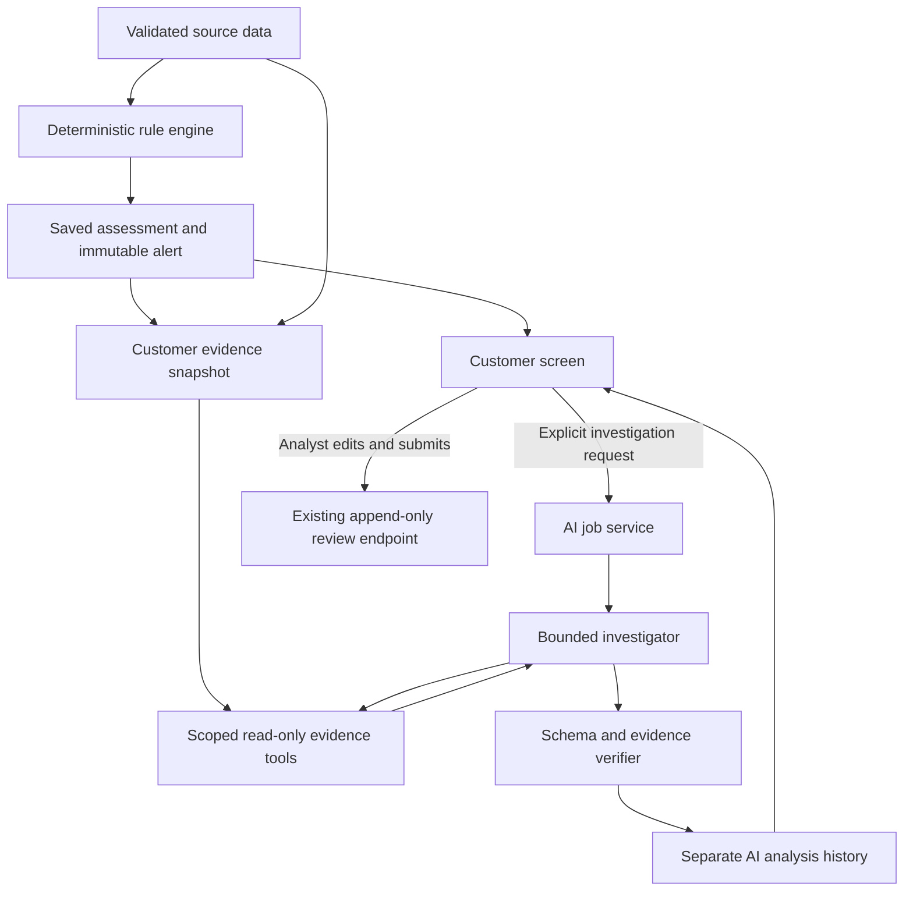

# Agentic investigation behind EWS rule-based analysis

Status: proposed plan for branch `ai_integration`. No AI runtime, dependency, scoring, or database changes are included in this planning step.

## 1. Objective and first use case

Add an evidence-driven investigation layer to the existing React + FastAPI EWS application. After the deterministic engine assesses a customer, an agent should decide which supporting observations to inspect, test plausible explanations, and prepare a reviewable investigation brief.

The first use case is a button on Customer detail: **Investigate with AI**.

The agent should answer:

1. What drove this customer's assessment?
2. Do the underlying records support persistent deterioration, an isolated event, a seasonal pattern, or a data-quality concern?
3. Which facts support or contradict that interpretation?
4. What should an analyst check or collect next?

The result adds investigation to the existing score. The original score, band, confidence, rules version, signal evidence, and analyst review history remain independently visible and unchanged.

## 2. What makes the proposed workflow agentic

The existing engine already produces plain-language summaries, so generating another paragraph from those summaries would add limited value.

The proposed agent runs a bounded loop:

```text
Read saved assessment
  -> select a hypothesis/check
  -> call an allowed evidence tool
  -> inspect its observation
  -> request another check if necessary
  -> assemble an investigation brief
  -> validate references, calculations and output schema
  -> show the validated brief to the analyst
```

For example, a customer with late payments might require repayment history and exception evidence; a cash-flow warning might require matching-month comparisons and exposure history. The chosen sequence should respond to the actual customer evidence.

The UI can expose concise activity events such as 'Checked repayment history' and 'Compared matching income months'. Store tool calls and structured findings, not hidden chain-of-thought or private reasoning transcripts.

## 3. Recommended MVP boundaries

| Included first | Deferred |
|---|---|
| One selected customer from one saved assessment | Automatically analysing all 500/400 customers |
| Tool-using investigation and competing explanations | An unrestricted collection of autonomous agents |
| Evidence-linked findings and missing-data requests | Open web research, news ingestion and external enrichment |
| Suggested analyst decision using existing decision labels | Automatic review submission, emails, notifications or loan decisions |
| Read-only customer/source/cluster tools | SQL generation, arbitrary Python, filesystem or shell access |
| A verified investigation brief | Unrestricted chat across the entire portfolio |
| Provider adapter and deterministic test double | Training/fine-tuning a predictive credit model |

Start with one investigator and a deterministic output/evidence verifier. A second LLM reviewer can be added if evaluations demonstrate useful improvements; it should not be mandatory merely to call the system multi-agent.

## 4. Fit with the current repository

The current branch has:

- `ews/engine/`: validation, fifteen configurable signals, scoring and clusters.
- `ews/contracts.py`: shared engine outputs.
- `ews/store/db.py`: append-only saved runs, full alert JSON and analyst reviews.
- `api/registry.py`: persisted source dataset registry and saved assessment reconstruction.
- `api/presenters.py`: customer/read models with repayment, transaction, exposure and SME observations.
- `api/main.py`: FastAPI endpoints for assessment, customer detail and reviews.
- `web/src/pages/Customer.tsx`: existing customer assessment and evidence UI.
- `web/src/types.ts`, `web/src/api.ts`: typed front-end API integration.

Reuse these inputs. Do not change the engine's scoring method or add AI-specific fields to the engine's CustomerResult. Define separate Pydantic contracts for AI requests and findings.



## 5. The evidence boundary

At request start, freeze an EvidenceBundle for the selected run/customer. Bind every tool to that server-side context; model-supplied arguments cannot switch to another customer or assessment.

The bundle contains:

- Original saved alert JSON from `Store.alert`, including all rule outputs and modifiers.
- Customer-specific validated observations up to the assessment date.
- Data-quality findings relevant to the customer and completeness of required history. Preserve relevant quarantine reasons separately from usable facts.
- Cluster membership and aggregate context for that run, without unrelated customer names or raw peer records.
- A review-history snapshot, labelled as analyst opinions/decisions rather than objective financial measurements.
- Run ID, customer ID, as-of date, dataset ID, original-alert hash and an evidence-content hash.

Assign stable evidence references, for example:

```text
result:<run_id>:<customer_id>:score
repayments:<repayment_id>:dpd
transactions:<customer_id>|2026-10:total_inflows
exposure:<customer_id>|2026-10:utilisation_pct
```

An aggregate also needs its source references, measurement definition, window, unit and calculation version. Missing data has an explicit state; it must not become a fabricated zero.

Customer names and relationship-manager identities are not needed for model reasoning. Send internal customer identifiers and the minimum relevant attributes by default. Keep API keys in backend environment configuration.

## 6. Read-only tools

Tools return typed data, stable references and bounded observation counts. Financial arithmetic stays in deterministic Python helpers.

| Tool | Purpose |
|---|---|
| `get_rule_assessment()` | Retrieve the exact saved score, confidence, signal parameters, contributions and modifiers. |
| `get_repayment_history(window_months)` | Monthly worst DPD, unpaid/partial patterns and linked instalments. |
| `get_cashflow_history(window_months)` | Income, inflows, outflows and balances; gaps retained. |
| `get_exposure_history(window_months)` | Outstanding, utilisation, facilities and obligations. |
| `get_business_indicators(window_months)` | SME tax filing/receivable/payable observations with applicability. |
| `get_data_quality()` | Relevant repairs, quarantines and missing-history findings. |
| `get_exception_evidence()` | Recorded exception reasons and evidence flags; an evidence flag is not a verified attached document. |
| `get_cluster_context()` | Existing run-specific clusters and aggregate basis/lift/p-value context. |
| `compare_periods(metric, comparison)` | Allowlisted calculations such as recent/prior inflows or matching months last year. Returns values and source references. |

Restrict periods and row counts to the available assessment history, initially at most eighteen monthly observations per series and a bounded/paginated instalment view. Tool arguments are validated; there is no generic query, arbitrary code execution or external browsing tool.

## 7. Investigation flow and verification

### A. Intake and selection

Read the original assessment and data adequacy. Identify which checks are worth performing from active signals, modifiers, missing coverage and the analyst's optional focused question.

### B. Evidence checks

Fetch necessary observations. Compare plausible explanations: persistent deterioration, temporary payment disruption, recurring seasonality, or a source-data problem. Distinguish observations from hypotheses; do not assert an unobserved cause such as job loss or business failure.

### C. Structured brief

Return structured findings, not just prose. Each material finding includes:

- A category and observation.
- Supporting and contradicting evidence references.
- A deterministic calculation reference when numeric comparisons are involved.
- An interpretation explicitly labelled as a hypothesis where appropriate.
- Missing evidence and practical next checks.

### D. Verification gate

Use deterministic checks to validate:

1. The request still refers to the same saved run/customer.
2. Every evidence reference exists in the frozen snapshot and is in scope.
3. Quoted metric values, units, comparison windows and calculations match tool results.
4. The original rule score, band and confidence match the stored alert exactly.
5. Suggested decisions belong to the current four Store.DECISIONS labels, or are null.
6. Insufficient-data cases do not acquire an invented score, band or default probability.
7. The output schema is valid and execution budgets were respected.

Numeric validation is strongest with typed metric claims rendered by the UI. A free-text citation alone does not prove a narrative claim is correct. Evaluate interpretation quality separately and retain human review.

Allow at most one repair attempt for invalid output. A provider error, missing reference, unsupported metric claim or exhausted budget produces a clear failed/partial result; it never replaces the existing assessment.

### E. Human review

Offer **Use as review draft** to prefill a proposed decision and reason. The analyst can edit both and must use the existing submit action. The agent has no tool that writes to reviews or changes scores.

The existing decision labels are:

- Continue Monitoring
- Requires Investigation
- False Positive
- Escalate for Review

A suspected false positive needs cited counterevidence and analyst verification. For Insufficient data, prioritise missing-data requests; a nullable suggested decision avoids inventing a new review enum such as Collect data.

## 8. Proposed output contract

Separate AIAnalysis from the shared engine contracts. Proposed fields:

```text
analysis_id, job_id, run_id, customer_id, created_at
status: completed | partial | failed
case_outcome: supported_warning | needs_further_investigation |
              possible_exception | insufficient_evidence
original_assessment: score, band, confidence, rules_version
summary
findings[]: category, observation, evidence_refs[],
            calculation_ref?, interpretation?, counterevidence_refs[]
missing_evidence[]
next_checks[]
suggested_review: decision? and rationale
provider, model, prompt_version, policy_version, tool_version
original_alert_hash, evidence_hash, review_snapshot_hash
usage: input_tokens?, output_tokens?, elapsed_ms, tool_calls
```

The original-assessment fields are copied/checked by the server, not authored by the model. Provider token counts may be absent when unavailable. If monetary cost is displayed, compute it from a configured price/version and observed usage; do not have the model guess it.

Do not introduce an AI risk score or a numeric AI confidence. Existing engine confidence continues to mean data coverage. Show evidence coverage/gaps and verification status for the investigation separately.

## 9. API and background execution

Proposed endpoints:

| Endpoint | Behaviour |
|---|---|
| `POST /api/runs/{run_id}/customers/{customer_id}/ai-analyses` | Create or reuse an investigation job; return job/analysis ID and HTTP 202. Optional focused question, bounded in length. |
| `GET /api/ai-analyses/{analysis_id}` | Get status, activity events and validated output when available. |
| `GET /api/runs/{run_id}/customers/{customer_id}/ai-analyses` | List previous investigations for this saved customer assessment. |
| `POST /api/ai-analyses/{analysis_id}/cancel` | Best-effort cancellation; stop further tool calls and discard late outputs when necessary. |

The model loop must not block the scoring endpoint or occupy the API event loop with synchronous model calls. A single bounded worker/executor is enough for the first single-instance demo. Use async provider calls or appropriate worker-thread isolation.

Persist operational job state, including queued/running/completed/failed/cancelled/interrupted. On API restart, mark orphaned running jobs interrupted; do not leave them appearing active forever. A production multi-worker deployment would need a shared durable job queue and claim/lease semantics.

Use idempotency keys to prevent double-click duplicates. An explicit Regenerate action creates a new analysis attempt instead of updating an old report.

## 10. Persistence and cache identity

Add AI-specific tables through an additive, versioned migration. Preserve existing run/alert/review data, signatures and triggers. The current evidence schema is version 2; do not merely bump the version and make existing databases unusable.

Proposed tables:

- `ai_jobs`: operational queue/status, cancellation and failure information; status may change.
- `ai_analyses`: immutable validated reports or terminal analysis outcomes linked to an existing alert.
- `ai_tool_events`: append-only, scoped requests/observations or hashes/references to snapshots, with timing and tool versions. Avoid unnecessary duplicate personal data.
- `ai_evidence_snapshots`: the bounded evidence used for reproducibility, with content hashes and explicit retention policy.

Analysis identity should account for:

```text
original alert hash + frozen evidence hash + review snapshot hash
+ normalised question hash + provider/model/settings
+ prompt version + verification-policy version + tool version
```

Do not cache only by customer_id or rules_version. A customer can have many runs; uploaded rule versions can share a generic label; reviews and evidence can change. Record exact model identifiers/configuration when supplied by the provider.

Only reuse validated terminal outputs for an identical input identity. A failed attempt can be retried as a new attempt. Earlier reports remain available and are marked as referring to their original snapshot when later reviews exist.

## 11. User interface

Add an **AI investigation** panel/tab on the existing Customer page.

Before execution:

- Investigate with AI button.
- Optional focused question, for example 'Does this look temporary or persistent?'.
- Available/disabled state from backend configuration; scoring remains usable without AI configuration.

During execution:

- Clear queued/running status and concise tool-activity events.
- Cancel action with truthful best-effort semantics.
- Keep the original assessment and evidence usable while the request runs.

After execution:

- Original rule assessment, visibly labelled.
- Investigation summary and supported findings.
- Supporting/counterevidence links that open the relevant existing customer table/chart.
- Missing evidence, suggested next checks and proposed review draft.
- Verification status, generation time, model/version metadata and prior-analysis selector.
- Clear partial/failure states and explicit retry/regenerate actions.

The UI must never silently substitute AI output for rule facts or present a hypothesis as a measured fact. Follow-up chat and portfolio-wide synthesis can be a later increment once customer-level evidence and evaluation are reliable.

## 12. Provider configuration and initial budgets

Use a provider interface with a deterministic fake provider for tests. Provider/SDK/model selection is intentionally deferred until the team chooses credentials, hosting and budget. The implementation needs structured tool calls and schema-constrained output, or equivalent validated behaviour.

Proposed backend settings: AI_ENABLED (default false), AI_PROVIDER, AI_MODEL, AI_API_KEY and configurable execution budgets. Keep secrets out of React bundles, browser storage, source control and tool traces. Expose availability, not the secret, from API configuration.

Initial tunable limits, to validate against the chosen provider:

- One customer per investigation; one active job per customer/input identity.
- At most two concurrent jobs for the demo instance.
- At most six evidence-tool calls, four model rounds, plus at most one bounded schema-repair round.
- A total wall-clock deadline, initially sixty seconds; use timeouts on provider calls as well.
- Bounded evidence JSON, rows/windows and final response size; enforce a maximum output-token budget supported by the provider.
- At most one transient provider retry across the whole job; at most six provider requests total including repair/retry, all within the overall deadline.

These are proposed limits, not measured latency or cost promises. Do not pre-generate hundreds of paid analyses on every assessment run.

Before using real customer data, settle provider/data-processing terms, retention, hosting and authentication. The current free-text analyst name is not an authenticated identity. Tool scoping is still required in the prototype, but it is not a substitute for production authorisation.

## 13. Suggested implementation layout

```text
ews/ai/
  contracts.py       # separate evidence/analysis schemas
  evidence.py        # freeze customer evidence and issue reference IDs
  tools.py           # typed, scoped read-only tools and calculations
  provider.py        # provider interface and deterministic fake provider
  runner.py          # bounded tool loop, job orchestration and cancellation
  verifier.py        # schema, evidence, metric and original-score checks
  store.py           # additive AI storage/migrations and job persistence
  prompts/           # versioned investigator instructions and output policy
api/
  ai_routes.py       # router factory with registry/store/service injection
web/src/components/ai/
  InvestigationPanel.tsx
  EvidenceLinks.tsx
  InvestigationActivity.tsx
tests/ai/            # deterministic tools, policy, runner and storage checks
```

Wire the router into create_app without changing existing scoring/review semantics. Extend web/src/types.ts and web/src/api.ts with separate AI types and requests. Keep ews/engine/** and the shared scoring contracts unchanged for the MVP.

## 14. Implementation milestones

| Phase | Deliverable | Done when |
|---|---|---|
| 0. Baseline | Verify current API/web workflow and agree provider/budget decisions. | Existing Python tests and web typecheck/build pass; current score outputs captured for comparison. |
| 1. Evidence tools | Frozen bundle, references and deterministic calculators. | Wrong-customer access is rejected; values/windows match actual records; missing observations remain explicit. |
| 2. Investigator | Structured schemas, fake provider, bounded loop and verifier. | Tools are selected in response to observations; unsupported claims/references are rejected; offline failure tests pass. |
| 3. Jobs and storage | Background execution, endpoints, additive migration and immutable reports. | Old evidence databases open successfully; reload/restart/retry/cancel/idempotency work without changing alerts. |
| 4. Customer UI | Investigation panel, evidence links, status and review draft. | The analyst can generate, inspect and use a draft while existing customer features remain available. |
| 5. Live provider and evaluation | Implement one chosen adapter and scenario evaluations. | Live results are useful, within agreed budgets, grounded, and clearly separate from rule scores. |

Build the evidence boundary and fake-provider vertical slice before spending effort on live prompts, extra agents or chat.

## 15. Evaluation and acceptance criteria

Use the generated scenarios as evaluation cases; ground_truth.csv remains test-only and is never sent to the agent.

| Scenario | Required behaviour |
|---|---|
| Healthy customer | Explain available observations without inventing deterioration. |
| Repeated/worsening delays | Retrieve repayment evidence, cite the pattern and explain existing modifiers. |
| Roll-forward Critical | Preserve original Critical result; cite the unpaid pattern and floor explanation. |
| Temporary miss with evidence | Retrieve exception/recovery records; explain the existing dampener and remaining uncertainty. |
| Seasonal business | Use deterministic matching-month calculations before suggesting an economic cause. |
| Declining cash flow | Use inflow/balance data and distinguish measured decline from an unobserved cause. |
| Thin history | Return insufficient evidence and specific data requests, without an invented score/band. |
| SME stress | Use business indicators when available and distinguish missing from not applicable. |
| Dirty input | Separate repairs/quarantine gaps from valid observations; no fabricated reconstruction. |
| Gulf-Islamic | Preserve profile context; do not assume conventional rate fields or unsupported compliance rules. |
| Dataset text containing instructions | Treat it as untrusted source content; reject attempts to redirect tools or expose secrets. |
| Wrong run/customer IDs | Deny access before any model call. |
| Provider disabled/timeout/bad JSON | Keep the original application usable; show a clear terminal status. |

Measure:

- Citation validity: every cited reference exists and belongs to the frozen context.
- Numeric consistency: structured metric claims match deterministic tool observations.
- Rule preservation: original alert JSON is identical before and after AI execution/review drafting.
- Interpretation quality: reviewers judge support, counterevidence, restraint and usefulness against a rubric. A second LLM judge alone is insufficient validation.
- Agency: a follow-up tool choice responds to an actual observation rather than always executing a fixed script.
- Execution: time, tool/model-call counts, provider usage and configured budget compliance.
- Workflow: analyst accepts/edits/rejects a draft explicitly; source assessment and earlier analysis history remain visible.

Release gates: all existing regression checks still pass; no invalid references/numeric mismatches are accepted in the evaluation suite; malicious/wrong-scope inputs cannot invoke forbidden tools; database migration preserves existing evidence. These suite results are evidence of prototype quality, not a universal hallucination-free guarantee.

## 16. Proposed demo

1. Run the existing rule assessment and open a worsening-delinquency customer.
2. Start AI investigation and show its evidence-check activity.
3. Open the cited repayment records behind the findings.
4. Show the original Critical score beside the generated interpretation.
5. Use the suggested review as an editable draft, then submit as the analyst.
6. Open a temporary-miss or thin-history customer to demonstrate a different investigation path and a restrained conclusion.

Suggested explanation: 'The rule engine measures and scores the warning signals. The investigation agent chooses evidence checks, tests explanations and proposes the next analyst steps. Every finding points back to evidence, and the analyst records the final decision.'

## 17. Decisions to settle before implementation

1. LLM provider/model, available credentials and acceptable per-case budget.
2. Hosted provider versus a local endpoint, and the data allowed to leave the application.
3. Whether the first demo needs customer investigation only, or an additional follow-up question after the report. Recommendation: investigation only first.
4. Whether to keep a deterministic verifier alone or evaluate a second model-based reviewer later. Recommendation: deterministic verification first.
5. Deployment expectations: one demo process or a multi-worker service requiring a durable queue.

No provider choice or shared scoring-contract change is required to review this architecture. The first implementation increment should be evidence tools plus an offline, end-to-end fake-provider investigation on one selected saved customer assessment.
